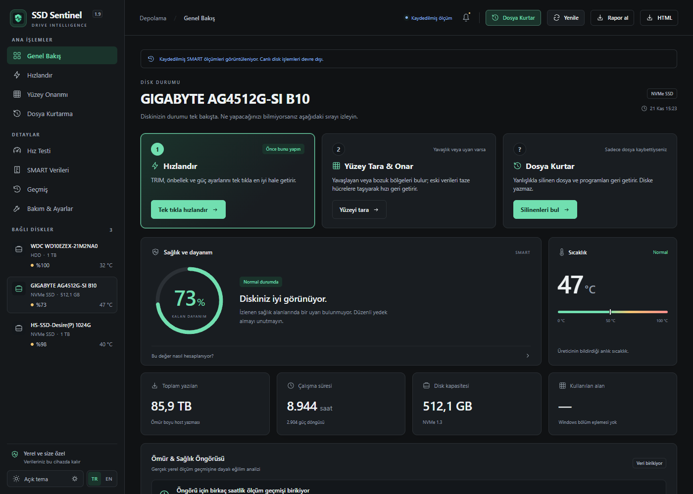
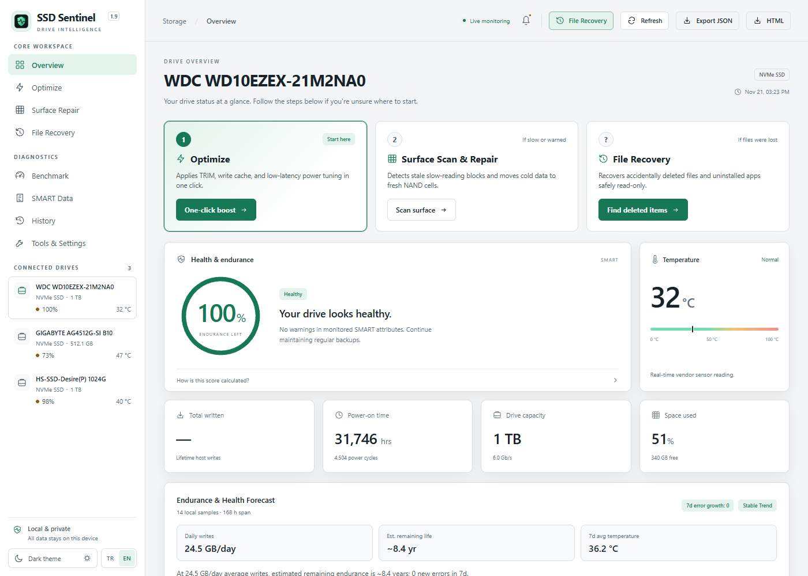
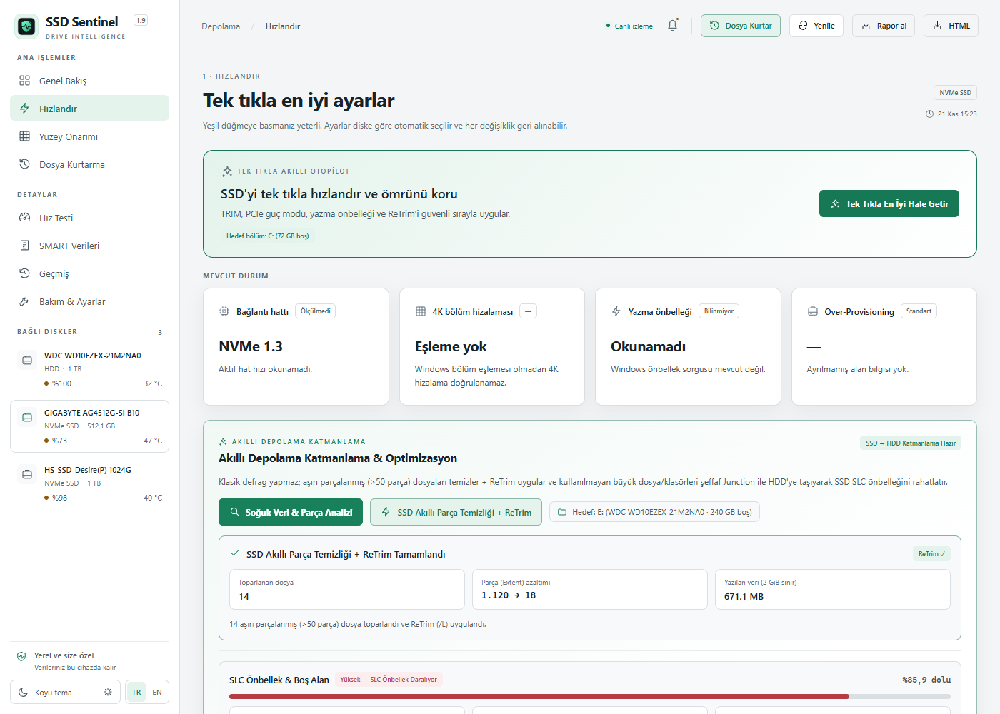
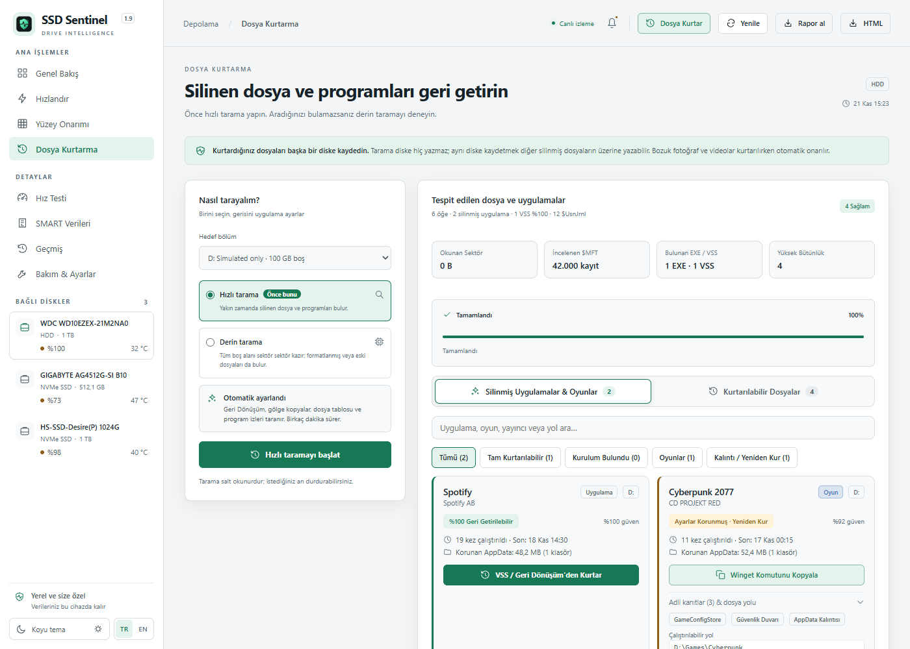

<div align="center">


# SSD Sentinel

**The local-first Windows disk suite built with Rust & Tauri 2.**<br/>
**SMART health & endurance forecasting · Win32 IOCP Direct-I/O benchmark · LBA surface repair · NTFS forensic recovery · Smart NTFS Junction tiering — all in a ~3.5 MB offline-first installer.**

[](https://github.com/yuefdev/ssd-sentinel/releases/latest)
[](https://github.com/yuefdev/ssd-sentinel/releases)
[](https://github.com/yuefdev/ssd-sentinel/actions/workflows/ci.yml)
[](LICENSE)
[-181e22?style=flat-square)](https://github.com/yuefdev/ssd-sentinel/releases/latest)
[](#türkçe-özet)

### [Download Windows Installer (`.exe`)](https://github.com/yuefdev/ssd-sentinel/releases/latest) · [All Releases & `SHA256SUMS.txt`](https://github.com/yuefdev/ssd-sentinel/releases) · [Contributing](CONTRIBUTING.md) · [Türkçe Özet](#türkçe-özet)

</div>

<br/>

<p align="center">
  
</p>

---

## Why Install 5 Separate Utilities?

Most Windows storage setups juggle one closed-source app for SMART monitoring, another for benchmarks, another for surface sector scanning, a separate uninstaller/file carver, and manual symlinks for SSD offloading—often bundled with adware, bloated Electron runtimes, or silent telemetry uploads.

**SSD Sentinel replaces all five in a single native Rust core (`~3.5 MB` NSIS installer) that keeps every byte on your PC:**

| Capability | What Old Tools Do | What SSD Sentinel Does |
|---|---|---|
| **SMART & Forecasting** | Static health guess or `100%` false pass when handles fail | Live NVMe, SATA SSD & HDD SMART via `smartctl`, **per-disk fault isolation** (`read_incomplete`), Default/Strict modes, 720-sample SQLite write-rate & years-left projections |
| **Raw Disk Benchmark** | External `.exe` wrappers or cached OS numbers | **Built-in Win32 IOCP Direct-I/O** (`FILE_FLAG_NO_BUFFERING \| OVERLAPPED`), SEQ/RND 4K MB/s, IOPS & µs latency with PCIe/SATA bus bottleneck detection |
| **Surface Scan & Repair** | Blind full-disk wipes or opaque "quick check" progress bars | **Read-only raw LBA 200-zone map**, thermal & error watchdog throttling, resumable scan checkpoints, `FSCTL_MOVE_FILE` pinpoint relocation & `.ssd-sentinel-quarantine` lock |
| **Smart Storage Tiering** | Dangerous SSD defrags or broken manual folder moves | Identifies cold SSD data (protecting SLC cache) & hot HDD folders, moves with **SHA-256 verification + transparent NTFS Directory Junctions** so games/apps keep working cleanly |
| **Forensic Recovery** | Paid recovery tiers locking preview or corrupting source sectors | Strictly **read-only** `$MFT`, `$UsnJrnl`, `$I30` slack, VSS Shadow Copies, Recycle Bin & carving, **Deleted Apps & Games reconstruction**, plus JPEG/PNG/MP4 buffer header repair |
| **Privacy & Updates** | Hidden analytics or silent background updaters | **Zero telemetry**, zero serial uploads, no background network traffic, **SHA-256 verified GitHub release updater** triggered only when you click |

---

## Visual Tour

<table align="center">
  <tr>
    <td width="50%" align="center">
      <br/>
      <sub><b>Instant EN / TR Localization &amp; Endurance Forecast</b> — Light &amp; dark themes, 7-day write-rate &amp; thermal trend metrics.</sub>
    </td>
    <td width="50%" align="center">
      <br/>
      <sub><b>One-Click Autopilot &amp; NTFS Tiering</b> — Hardware cache, TRIM, PCIe ASPM, Over-Provisioning &amp; SHA-256 folder offloading.</sub>
    </td>
  </tr>
  <tr>
    <td width="50%" align="center">
      <br/>
      <sub><b>200-Zone Surface &amp; Pinpoint Repair</b> — Adaptive threshold diagnosis, ZBR speed curve &amp; live cancellable task bar.</sub>
    </td>
    <td width="50%" align="center">
      <br/>
      <sub><b>Deleted Apps &amp; Forensic Recovery</b> — Recovers lost apps, AppData configs, `winget` commands, images &amp; archives read-only.</sub>
    </td>
  </tr>
</table>

---

## Key Highlights

- **Bilingual Desktop UI & System Tray (`EN` / `TR`):** Switch seamlessly from the sidebar toggle or **Tools & Settings**; syncs tray menus, alerts (`55 °C` warning / `50 °C` hysteresis reset), and tooltips (`—` for unreported metrics).
- **Verified In-App GitHub Updater:** Clicking **Check for updates** queries [`yuefdev/ssd-sentinel` Releases](https://github.com/yuefdev/ssd-sentinel/releases) over HTTPS (`WinHTTP`), lets you review release notes, and verifies downloaded installers cryptographically against `SHA256SUMS.txt` before launching—aborted and deleted on any hash mismatch or foreign host redirect.
- **Per-Disk Error Isolation:** On systems where non-admin access blocks a SATA controller while NVMe drives remain readable, healthy NVMe drives stay live (`stale: false`) and a non-blocking banner lets you elevate with one click when needed.
- **Chunked Job Cancellation & Safe Rollback:** System settings changed through Autopilot/Tuning archive prior values in SQLite for rollback; NTFS tier relocations copy chunk-by-chunk with instant Stop button response (`cancel_job`) and one-click restore.

---

## Safety & Privacy Invariants

| Safeguard | Guarantee |
|---|---|
| **Confirmation Gates** | Every mutating action (benchmark temp payload, optimization toggle, partition shrink, surface repair, tier relocation) requires modal confirmation + deterministic IPC token checked in [`core.rs`](src-tauri/src/core.rs). |
| **Read-Only Scans & Recovery** | SMART polling, physical LBA surface scanning, forensic index parsing, and file preview open storage read-only; restored files save only to user-picked external locations. |
| **No Telemetry / Offline-First** | Drive serial numbers (`WWN`, `EUI-64`), filenames, and health logs stay under `%LOCALAPPDATA%\SSD Sentinel`. JSON/HTML report export defaults to `redact: true`. |
| **Strict Download Host Allowlist** | In-app update downloads accept only HTTPS redirects across official GitHub origins (`github.com`, `api.github.com`, `*.githubusercontent.com`) and enforce `SHA256SUMS.txt`. |

---

## Install or Build from Source

### Option 1 — Quick Install (Recommended)
Download [`SSD Sentinel_1.9.0_x64-setup.exe`](https://github.com/yuefdev/ssd-sentinel/releases/latest) and verify its checksum against `SHA256SUMS.txt` from the [GitHub Releases](https://github.com/yuefdev/ssd-sentinel/releases) page. WebView2 runtime uses Microsoft's lightweight bootstrapper if not already present on Windows 10/11.

### Option 2 — Try Without Touching Disks (Snapshot Replay Mode)
Test the UI and inspect sample HDD + NVMe telemetry safely with zero physical disk access using anonymized repo fixtures:

```powershell
.\ssd-sentinel.exe --snapshot-dir .\src-tauri\tests\fixtures
```

### Option 3 — Build Locally

**Prerequisites:** Windows 10/11 (`x64`), stable Rust toolchain (`cargo`, `rustfmt`, `clippy`), Node.js `>= 22`, and `smartmontools 7.5` (`smartctl.exe`, `drivedb.h`, `COPYING.txt`, `checksums64.txt`) placed under `tools/smartmontools/` (excluded from Git; see [THIRD_PARTY.md](THIRD_PARTY.md)).

```powershell
npm ci
npm test
npm run build

cargo fmt --manifest-path src-tauri/Cargo.toml -- --check
cargo clippy --manifest-path src-tauri/Cargo.toml --all-targets -j 1 -- -D warnings
cargo test --manifest-path src-tauri/Cargo.toml --no-default-features -j 1
cargo test --manifest-path src-tauri/Cargo.toml -j 1

npm run tauri -- build --bundles nsis
```

---

## Contribute & Help Shape SSD Sentinel

We actively welcome contributors! Whether you want to test hardware edge cases, add vendor SMART curves, improve forensics/recovery parsers, or refine UI accessibility:

- Read [CONTRIBUTING.md](CONTRIBUTING.md) for local test setup & safety checklist
- Browse or open [Bug Reports & Feature Requests](https://github.com/yuefdev/ssd-sentinel/issues)
- Review our [Security Policy](SECURITY.md) & [Changelog](CHANGELOG.md)

---

## Türkçe Özet

**SSD Sentinel**, Windows sistemler için **Rust + Tauri 2** ile sıfırdan geliştirilmiş; tamamen yerel çalışan, reklamsız, telemetrisiz ve anlık **TR / EN** dil destekli kapsamlı bir disk sağlığı ve bakım paketidir.

- **Tek Tıkla Bakım & Akıllı Katmanlama:** TRIM, PCIe ASPM, donanım önbelleği, Over-Provisioning ve aşırı parçalanmış/soğuk klasörleri **SHA-256 doğrulaması + NTFS Directory Junction** ile kısayolları bozmadan taşıma ve geri alma.
- **Win32 IOCP Hız Testi & 200 Bölgeli Yüzey Onarımı:** Yerleşik Direct-I/O hız testi, ham LBA yüzey tarama haritası, ZBR hız profili ve `FSCTL_MOVE_FILE` ile yavaş/zayıf sektör tazeleme.
- **Salt-Okunur Adli Kurtarma:** `$MFT`, `$UsnJrnl`, `$I30`, VSS Gölge Kopya ve imza kazıma ile silinmiş dosya/oyun/program tespiti ve bozuk JPEG/PNG/MP4 başlık onarımı.
- **Doğrudan GitHub Güncellemeleri:** Ayarlar bölümünden [`yuefdev/ssd-sentinel`](https://github.com/yuefdev/ssd-sentinel/releases) sürümlerini kontrol edebilir, kurulum paketini `SHA256SUMS.txt` doğrulamasıyla tek tıkla başlatabilirsiniz.

---

## Licensing

Original Rust, TypeScript, CSS, SVG, and UI source code in **SSD Sentinel** is licensed under the [MIT License](LICENSE).

Windows distributions bundle upstream **smartmontools 7.5** (`smartctl.exe`, GNU **GPL-2.0-or-later**) in a separate subdirectory alongside matching upstream source archives (`RELEASE_7_5.tar.gz`) on GitHub Releases — see [THIRD_PARTY.md](THIRD_PARTY.md) for full dependency notices.
