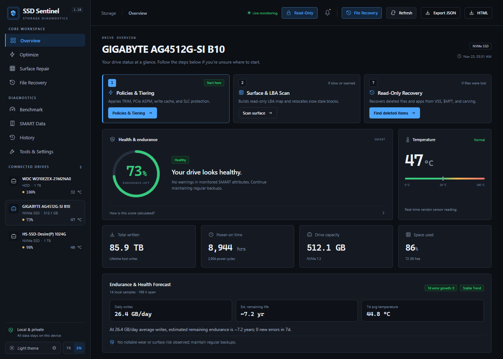
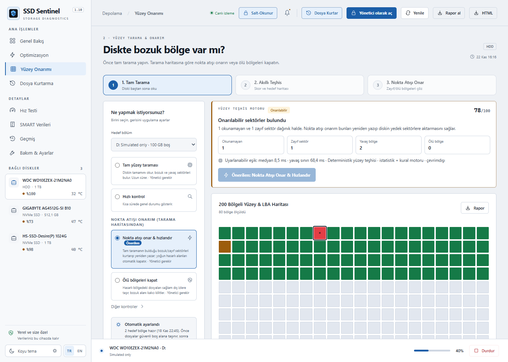

<div align="center">


# SSD Sentinel

**The local-first Windows storage diagnostics & safety suite built with Rust & Tauri 2.**<br/>
**SMART health & endurance forecasting · Win32 IOCP Direct-I/O benchmark · Deterministic LBA surface triage & repair · Read-only NTFS forensic recovery · SHA-256 NTFS Junction tiering — all in a ~3.5 MB offline-first installer.**

[](https://github.com/yuefdev/ssd-sentinel/releases/latest)
[](https://github.com/yuefdev/ssd-sentinel/releases)
[](https://github.com/yuefdev/ssd-sentinel/actions/workflows/ci.yml)
[](LICENSE)
[-0c0f14?style=flat-square)](https://github.com/yuefdev/ssd-sentinel/releases/latest)
[](#türkçe-özet)

### [Architecture Spec](docs/ARCHITECTURE.md) · [Safety & Crash Spec](docs/SAFETY_SPEC.md) · [Download Installer (`.exe`)](https://github.com/yuefdev/ssd-sentinel/releases/latest) · [Releases & `SHA256SUMS.txt`](https://github.com/yuefdev/ssd-sentinel/releases) · [Türkçe Özet](#türkçe-özet)

</div>

<br/>

<p align="center">
  
</p>

---

## Engineering Transparency & Clean-Room Architecture

Disk utilities carry real data-loss risk. **SSD Sentinel** is built from scratch in Rust and TypeScript against documented Windows Win32/NTFS kernel interfaces (`CreateFileW`, `FSCTL_MOVE_FILE`, `FSCTL_SET_REPARSE_POINT`, `IOCTL_DISK_*_CACHE_INFORMATION`, Win32 IOCP) and upstream `smartmontools` (`smartctl.exe`, GNU GPLv2+)—with **zero hidden telemetry**, **zero AI/ML models**, and full safety specifications open for review:

- **[`docs/ARCHITECTURE.md`](docs/ARCHITECTURE.md)** — Layered topology, WebView2 CSP & IPC trust boundaries, full module-by-module Read/Write matrix, verified Win32/IOCTL/FSCTL inventory, and SQLite 11-table persistence schema.
- **[`docs/SAFETY_SPEC.md`](docs/SAFETY_SPEC.md)** — Enforceable invariants (S1–S10), Default Read-Only Guard, Dry-Run execution manifests, Crash-Consistency & Power-Loss matrix, 25-entry system path firewall, and supply-chain verification rules.

| Capability | Safety & Engineering Design |
|---|---|
| **Default Read-Only Guard** | Fresh installs boot with `read_only_guard = true` enforced in Rust ([`core.rs`](src-tauri/src/core.rs)). All mutating jobs, IOCTLs, and tier moves are blocked at the core boundary until explicitly unlocked in the toolbar or Settings. |
| **Dry-Run Execution Manifest** | Every mutating confirmation modal displays a structured **Dry-Run Preview** listing target volume, Win32/CLI APIs invoked, write budget, rollback path, and the deterministic IPC token checked in Rust. |
| **SMART & Forecasting** | Live NVMe, SATA SSD & HDD SMART via `smartctl`, **per-disk fault isolation** (`read_incomplete`), Default/Strict modes, 720-sample SQLite write-rate & years-left projections. |
| **Raw Disk Benchmark** | Built-in **Win32 IOCP Direct-I/O** (`FILE_FLAG_NO_BUFFERING \| OVERLAPPED`), SEQ/RND 4K MB/s, IOPS & µs latency with PCIe/SATA link bottleneck detection. |
| **Surface Scan & Pinpoint Repair** | **Read-only raw LBA 200-zone map**, thermal (`53 °C`) & SMART cascade (`+8` reallocated) watchdogs, deterministic statistical triage ([`surface_triage.rs`](src-tauri/src/surface_triage.rs)), resumable checkpoints, `FSCTL_MOVE_FILE` relocation & `.ssd-sentinel-quarantine`. |
| **Smart Storage Tiering** | Blocks classic SSD defrag; identifies cold SSD data & hot HDD folders (respecting 25 protected system paths & 10 GiB reserve), relocates with **SHA-256 verification + native `FSCTL_SET_REPARSE_POINT` NTFS Junctions** and one-click rollback. |
| **Developer & WSL2 Storage** | Read-only radar for rebuildable project artifacts (`node_modules`, `target`, `.venv` — `.git`/`.env*` untouched), local LLM/package cache offloading via junctions, **WSL2/Docker `.vhdx` compaction**, and Win32 Long Paths / NTFS 8.3 toggles. |
| **Forensic Recovery** | Strictly **read-only** `$MFT`, `$UsnJrnl`, `$I30` slack, VSS Shadow Copies, Recycle Bin & carving, **Deleted Apps & Games reconstruction**, plus JPEG/PNG/MP4 buffer header repair. |

---

## Visual Tour

<table align="center">
  <tr>
    <td width="50%" align="center">
      <br/>
      <sub><b>Precision Storage Lab UI &amp; EN/TR Localization</b> — Light &amp; dark themes, tabular monospace telemetry, and endurance forecast.</sub>
    </td>
    <td width="50%" align="center">
      <br/>
      <sub><b>Policy Profiles &amp; SHA-256 NTFS Tiering</b> — Hardware cache, TRIM, PCIe ASPM, Over-Provisioning &amp; Junction offloading.</sub>
    </td>
  </tr>
  <tr>
    <td width="50%" align="center">
      <br/>
      <sub><b>200-Zone LBA Surface &amp; Pinpoint Repair</b> — Deterministic adaptive threshold triage, ZBR speed curve &amp; live task bar.</sub>
    </td>
    <td width="50%" align="center">
      <br/>
      <sub><b>Deleted Apps &amp; Forensic Recovery</b> — Recovers lost apps, AppData configs, `winget` hints, images &amp; archives read-only.</sub>
    </td>
  </tr>
</table>

---

## CI/CD, Staging & Verifiable Releases

Every pull request and release runs through automated Windows verification in [`.github/workflows/ci.yml`](.github/workflows/ci.yml) and [`.github/workflows/release.yml`](.github/workflows/release.yml):

1. **Automated Unit, Lint & Mock-IPC UI Smoke:** TypeScript unit tests (`npm test`), Vite type-check build, `rustfmt`, `clippy -D warnings`, Rust core (`--no-default-features`) + desktop tests, and Playwright UI verification across TR/EN and 390px viewports (`tools/smoke_tauri.mjs`).
2. **Real NTFS VHDX Integration Tests (`tools/vhdx_integration_test.ps1`):** Ephemeral 128 MB NTFS `.vhdx` virtual disks are attached on `windows-latest` CI runners to test the 10 GiB free-space reserve guard, real Win32 `FSCTL_SET_REPARSE_POINT` cross-volume NTFS Directory Junctions, mid-copy fault-injection cancellation, and SHA-256 rollback.
3. **Supply-Chain Audits:** `npm audit --omit=dev` and `cargo audit` run against lockfiles on CI.
4. **Staging & Release Channels:**
   - **Staging Dry-Runs:** `workflow_dispatch` builds upload staged NSIS artifacts + `SHA256SUMS.txt` without publishing publicly.
   - **Release Candidates (`v*-rc.*`, `v*-beta.*`):** Published as GitHub Pre-Releases for staged testing.
   - **Production Releases (`vX.Y.Z`):** Published with `SHA256SUMS.txt` and SLSA GitHub Build Provenance Attestations (`actions/attest-build-provenance@v2`).

Verify any downloaded release binary against GitHub Build Provenance and checksums:

```powershell
gh attestation verify "SSD-Sentinel_<version>_x64-setup.exe" --owner yuefdev
```

> **SmartScreen Notice:** Community installers are currently open-source unsigned builds (no commercial Authenticode certificate). Verify `SHA256SUMS.txt` or `gh attestation verify`, or inspect/build directly from source below.

---

## Install or Build from Source

### Option 1 — Quick Install (Recommended)
Download the latest installer from [GitHub Releases](https://github.com/yuefdev/ssd-sentinel/releases/latest) and verify its checksum against `SHA256SUMS.txt` (or `gh attestation verify`). WebView2 uses Microsoft's lightweight bootstrapper if not already present on Windows 10/11.

### Option 2 — Try Without Touching Disks (Snapshot Replay Mode)
Inspect the UI and test sample HDD + NVMe telemetry safely with **zero physical disk access** using anonymized repo fixtures:

```powershell
.\ssd-sentinel.exe --snapshot-dir .\src-tauri\tests\fixtures
```

### Option 3 — Build & Verify Locally

**Prerequisites:** Windows 10/11 (`x64`), stable Rust toolchain (`cargo`, `rustfmt`, `clippy`), Node.js `>= 22`, and `smartmontools 7.5` (`smartctl.exe`, `drivedb.h`, `COPYING.txt`, `checksums64.txt`) placed under `tools/smartmontools/` (excluded from Git; see [THIRD_PARTY.md](THIRD_PARTY.md)).

```powershell
npm ci
npm test
npm run build

cargo fmt --manifest-path src-tauri/Cargo.toml -- --check
cargo clippy --manifest-path src-tauri/Cargo.toml --all-targets -j 1 -- -D warnings
cargo test --manifest-path src-tauri/Cargo.toml --no-default-features -j 1
cargo test --manifest-path src-tauri/Cargo.toml -j 1

npm run tauri -- build --bundles nsis
```

*(Elevated Administrators can also execute the real NTFS VHDX integration suite locally via `pwsh -NoProfile -File tools/vhdx_integration_test.ps1`.)*

---

## Contribute & Help Shape SSD Sentinel

- Read [`docs/ARCHITECTURE.md`](docs/ARCHITECTURE.md), [`docs/SAFETY_SPEC.md`](docs/SAFETY_SPEC.md), and [`CONTRIBUTING.md`](CONTRIBUTING.md)
- Browse or open [Bug Reports & Feature Requests](https://github.com/yuefdev/ssd-sentinel/issues)
- Review our [Security Policy](SECURITY.md) & [Changelog](CHANGELOG.md)

---

## Türkçe Özet

**SSD Sentinel**, Windows sistemler için **Rust + Tauri 2** ile sıfırdan (clean-room mühendislik ve belgelenmiş Win32/NTFS arayüzleriyle) geliştirilmiş; tamamen yerel çalışan, reklamsız, telemetrisiz ve anlık **TR / EN** dil destekli açık kaynak disk sağlığı ve bakım paketidir.

- **Varsayılan Salt-Okunur Kalkan (`read_only_guard`):** Uygulama ilk açılışta yazma kilidi etkin başlar; hız testi, yüzey onarımı, optimize ve NTFS katmanlama işlemleri Rust çekirdeğinde engellenir. Kilidi açtığınızda bile her yazma işlemi öncesi hedef, Win32/CLI API'ler, yazma bütçesi ve geri alma yolunu gösteren **Dry-Run Etki Önizlemesi** sunulur.
- **Şeffaf Mimari & Güvenlik Şartnamesi:** Tüm modül sınırları [`docs/ARCHITECTURE.md`](docs/ARCHITECTURE.md) ve çökme/elektrik kesintisi senaryoları [`docs/SAFETY_SPEC.md`](docs/SAFETY_SPEC.md) içinde belgelenmiştir.
- **Gerçek NTFS VHDX Doğrulaması & Tedarik Zinciri:** Her PR'da `cargo audit` / `npm audit` ile birlikte sanal NTFS VHDX diskler üzerinde gerçek `FSCTL_SET_REPARSE_POINT` junction ve SHA-256 rollback testleri koşar; sürümler `SHA256SUMS.txt` ve SLSA Build Provenance kanıtıyla yayımlanır.

---

## Licensing

Original Rust, TypeScript, CSS, SVG, and UI source code in **SSD Sentinel** is licensed under the [MIT License](LICENSE).

Windows distributions bundle upstream **smartmontools 7.5** (`smartctl.exe`, GNU **GPL-2.0-or-later**) in a separate subdirectory alongside matching upstream source archives (`RELEASE_7_5.tar.gz`) on GitHub Releases — see [THIRD_PARTY.md](THIRD_PARTY.md) for full dependency notices.
