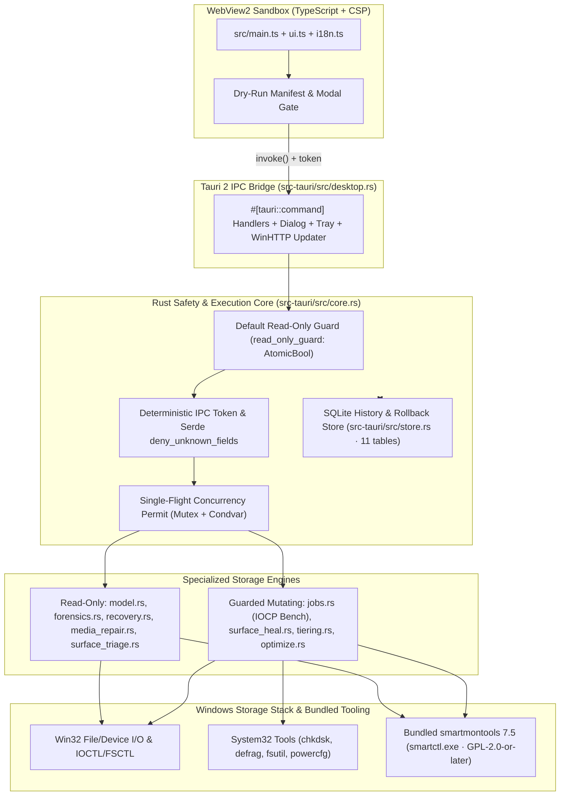
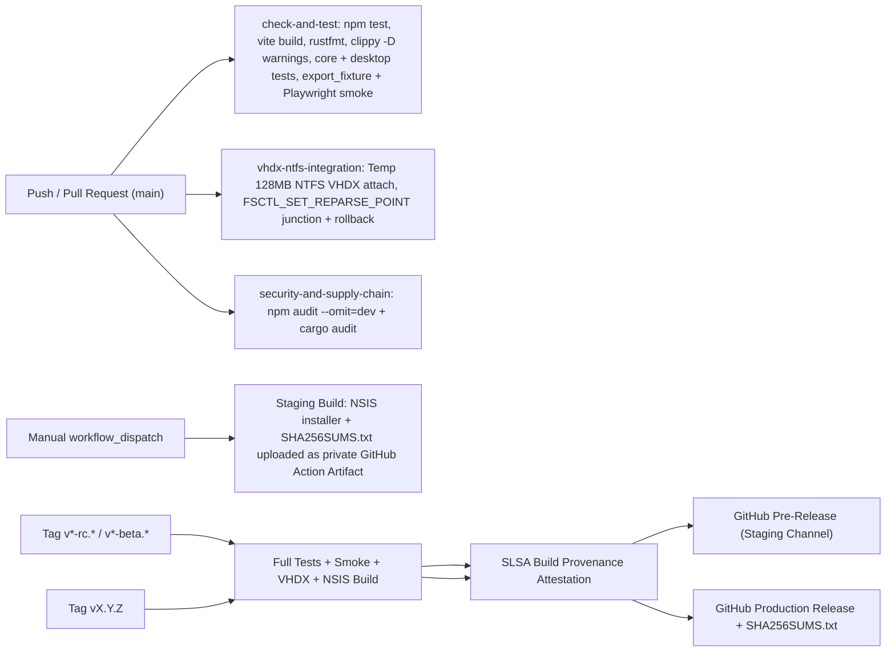

# SSD Sentinel — System Architecture Specification

> **Clean-Room Engineering Statement:** SSD Sentinel is implemented from scratch in Rust, TypeScript, CSS, and PowerShell against documented Windows Win32/NTFS kernel interfaces (`CreateFileW`, `DeviceIoControl`, `FSCTL_*`, `IOCTL_*`, `SetupDi*`, `WinHttp`) and upstream GPLv2+ `smartmontools` (`smartctl.exe`). No proprietary third-party code or runtime binaries are embedded or reverse-engineered into the codebase.

---

## 1. Layered System Topology

### Trust & Privilege Boundaries

1. **WebView2 UI (`src/`)** runs under a strict Content Security Policy defined in [`tauri.conf.json`](../src-tauri/tauri.conf.json):
   `default-src 'self'; script-src 'self'; style-src 'self' 'unsafe-inline'; img-src 'self' data:; connect-src ipc: http://ipc.localhost; object-src 'none'; base-uri 'none'; form-action 'none'; frame-src 'none'`.
2. **IPC Boundary (`desktop.rs` / `core.rs`)** deserializes structured requests (`JobRequest`, `OptimizeRequest`) with `#[serde(deny_unknown_fields)]`, validates option allowlists, checks deterministic confirmation tokens, enforces `read_only_guard` on all mutating paths, and binds operations to a unique physical drive identity verified against live Windows volume geometry.
3. **Host Storage Stack** is only accessed from Rust using fixed-argument `Command::arg` invocations (`smartctl.exe`, `System32\chkdsk.exe`, `defrag.exe`, `fsutil.exe`, `powercfg.exe`) or direct Win32 FFI calls (`windows-sys`). Shell string interpolation (`cmd.exe /c`) is never used.

---

## 2. Rust Module Inventory & Read/Write Matrix

| Module | Role | Disk Access | Network Access | Requires Write Guard Unlocked |
|---|---|---|---|---|
| [`core.rs`](../src-tauri/src/core.rs) | App state, `Permit` lock, `read_only_guard`, confirmation verification | Config/SQLite only | None | Enforces guard |
| [`desktop.rs`](../src-tauri/src/desktop.rs) | Tauri 2 IPC commands, tray, native dialogs, explicit GitHub updater | Temp update dir only | User-clicked HTTPS (`WinHttp`) | N/A |
| [`model.rs`](../src-tauri/src/model.rs) | SMART JSON normalization, health scoring, 7-day forecast | None (pure data) | None | No |
| [`platform.rs`](../src-tauri/src/platform.rs) | `smartctl` spawn, SetupAPI/CfgMgr PCIe queries, physical/volume mapping | Read-only queries (`ReTrim` gated) | None | Only `ReTrim` |
| [`process.rs`](../src-tauri/src/process.rs) | Bounded child process runner with timeout & cancellation reaping | None | None | No |
| [`store.rs`](../src-tauri/src/store.rs) | Local SQLite persistence (`%LOCALAPPDATA%\SSD Sentinel\history.sqlite3`) | Local SQLite DB | None | No |
| [`report.rs`](../src-tauri/src/report.rs) | JSON / HTML diagnostic export & serial/WWN redaction | User-picked path | None | No |
| [`surface_triage.rs`](../src-tauri/src/surface_triage.rs) | Deterministic adaptive latency baseline & repair planning (zero AI/ML) | None (pure math/rules) | None | No |
| [`forensics.rs`](../src-tauri/src/forensics.rs) | `$UsnJrnl`, `$I30` slack, Prefetch, ShimCache, UserAssist, VSS parsing | **Strictly Read-Only** | None | No |
| [`recovery.rs`](../src-tauri/src/recovery.rs) | `$MFT` / Recycle Bin / VSS / header carving, external restoration | Read-only source; writes only to user-picked dest | None | No |
| [`media_repair.rs`](../src-tauri/src/media_repair.rs) | In-memory JPEG/PNG/GIF/BMP/MP4/MKV structural repair | Memory buffers only | None | No |
| [`jobs.rs`](../src-tauri/src/jobs.rs) | Win32 IOCP Direct-I/O benchmark, file read/write surface checks | Temp payload on target volume | None | **Yes** (except `defrag /A`) |
| [`surface_heal.rs`](../src-tauri/src/surface_heal.rs) | Raw LBA 200-zone scan, 4K sector micro-probe, pinpoint relocation, quarantine | `physical_scan`: Read-only; repair/isolate: Mutating | None | **Yes** for repair/isolate |
| [`tiering.rs`](../src-tauri/src/tiering.rs) | Hot/cold candidate scoring, SHA-256 relocation, `FSCTL_SET_REPARSE_POINT` junctions | Analysis: Read-only; relocate/rollback/tier job: Mutating | None | **Yes** for relocate/rollback/tier jobs |
| [`dev_workspace.rs`](../src-tauri/src/dev_workspace.rs) | Developer project artifact radar, AI model/package cache & WSL/Docker VHDX discovery, allowlisted safe cleaning | Analysis: Read-only; `clean_dev_artifact`: Mutating | None | **Yes** for `clean_dev_artifact` |
| [`optimize.rs`](../src-tauri/src/optimize.rs) | Write cache IOCTL, TRIM, PCIe ASPM, hibernation, APM, OP shrink/extend, `long_paths`, `ntfs_8dot3`, `compact_wsl_vhdx` | `query_op_bounds`: Read-only; mutations: Mutating | None | **Yes** (except `query_op_bounds`, `autostart`) |

---

## 3. Verified Windows Kernel API & Tooling Inventory

| Interface / Binary | Module(s) | Direction & Purpose |
|---|---|---|
| `CreateFileW` + `FILE_FLAG_NO_BUFFERING \| FILE_FLAG_OVERLAPPED` + IOCP | `jobs.rs`, `surface_heal.rs` | Unbuffered direct raw LBA read scans and controlled benchmark throughput measurement |
| `FSCTL_GET_VOLUME_BITMAP` (`0x0009006F`) | `surface_heal.rs`, `tiering.rs` | Queries free cluster spans before locating safe relocation/outer-track destinations |
| `FSCTL_GET_RETRIEVAL_POINTERS` (`0x00090073`) | `surface_heal.rs`, `tiering.rs` | Maps file cluster extents (`LCN`) without modifying data |
| `FSCTL_MOVE_FILE` (`0x00090074`) | `surface_heal.rs`, `tiering.rs` | Atomically relocates file clusters off slow/weak regions or onto outer tracks via NTFS |
| `FSCTL_SET_REPARSE_POINT` (`0x000900A4`) | `tiering.rs` | Creates `IO_REPARSE_TAG_MOUNT_POINT` NTFS Directory Junctions natively (no `mklink` shell) |
| `IOCTL_DISK_GET_CACHE_INFORMATION` / `IOCTL_DISK_SET_CACHE_INFORMATION` | `optimize.rs` | Reads and updates storage controller write-caching policy (`PhysicalDriveN`) |
| `SetupDiGetClassDevsW`, `CM_Get_Parent`, `CM_Get_DevNode_PropertyW` | `platform.rs` | Queries PCIe link width & speed properties (`DEVPKEY_PciDevice_*`) read-only |
| `WinHttp*` (`WinHttpOpen`, `WinHttpConnect`, etc.) | `desktop.rs` | User-initiated HTTPS release checks & SHA-256 verified update download (host allowlist enforced) |
| `smartctl.exe` (`--scan-open`, `-i -H -A`, `-a`, `-t`, `-X`, `-s apm`) | `core.rs`, `platform.rs`, `optimize.rs` | SMART JSON telemetry, log reading, firmware self-test triggers, HDD APM level |
| `RegSetKeyValueW` (`LongPathsEnabled`) | `optimize.rs` | Enables/disables Win32 >260-character path support with SQLite rollback |
| `chkdsk.exe /scan`, `defrag.exe /A /O /X /L`, `fsutil.exe`, `powercfg.exe` | `jobs.rs`, `surface_heal.rs`, `tiering.rs`, `optimize.rs` | Invoked strictly via `System32` absolute path + `Command::arg` vectors |
| `wsl.exe --shutdown` + `diskpart.exe /s` (`compact vdisk`) | `optimize.rs`, `dev_workspace.rs` | Shuts down WSL and compacts validated WSL2 / Docker `ext4.vhdx` / `docker_data.vhdx` virtual disks read-only |

---

## 4. Local SQLite Persistence (`store.rs`)

All operational history, checkpoints, and rollback baselines stay in `%LOCALAPPDATA%\SSD Sentinel\history.sqlite3` across **11 tables**:

- **Telemetry & Alerts:** `samples` (90-day retention, up to 720 samples per disk queried), `events` (up to 200 latest threshold/counter deltas).
- **Job Archives (latest 20 per table):** `benchmarks`, `surface_scans`, `defrag_jobs`, `autopilot_jobs`, `recovery_jobs`, `tier_jobs`.
- **Crash-Safe Resumption & Rollback State:**
  - `surface_checkpoints` — persisted every 5 completed LBA zones so interrupted full scans can resume safely (`resume: true`).
  - `optimizations` — records original pre-change values (`write_cache`, `ntfs_trim`, `pcie_aspm`, `hibernation`, `hdd_apm`, `op`, `tail`, `quarantine`) for one-click revert.
  - `tier_moves` — tracks cross-volume SHA-256 relocations and NTFS Directory Junction metadata for verified one-click rollback.

---

## 5. CI/CD, Staging & Provenance Pipeline

- **Reproducible Offline Replay:** Developers and reviewers can inspect the full application and Rust IPC boundary without touching physical disks using `--snapshot-dir src-tauri/tests/fixtures`.
- **Verification Reports:** Every release verifies native WebView2 and unit/integration suites documented in [`docs/VERIFICATION.md`](VERIFICATION.md).
